# Pokemon Ranch Pets

[繁體中文](README.md) | **English** | [日本語](README.ja.md)

A desktop pet that makes what your AI coding agents are doing *visible*. Works on macOS and Windows.

A 3D isometric island sits on your desktop, and **every Claude Code / Codex session adopts a first-generation Pokémon**. The pets roam the ranch freely, and a cloud bubble above each one shows what its agent is doing. When an agent needs your approval, hits an error or finishes, the pet tells you with colors and sounds — no more switching between sessions to check on them.

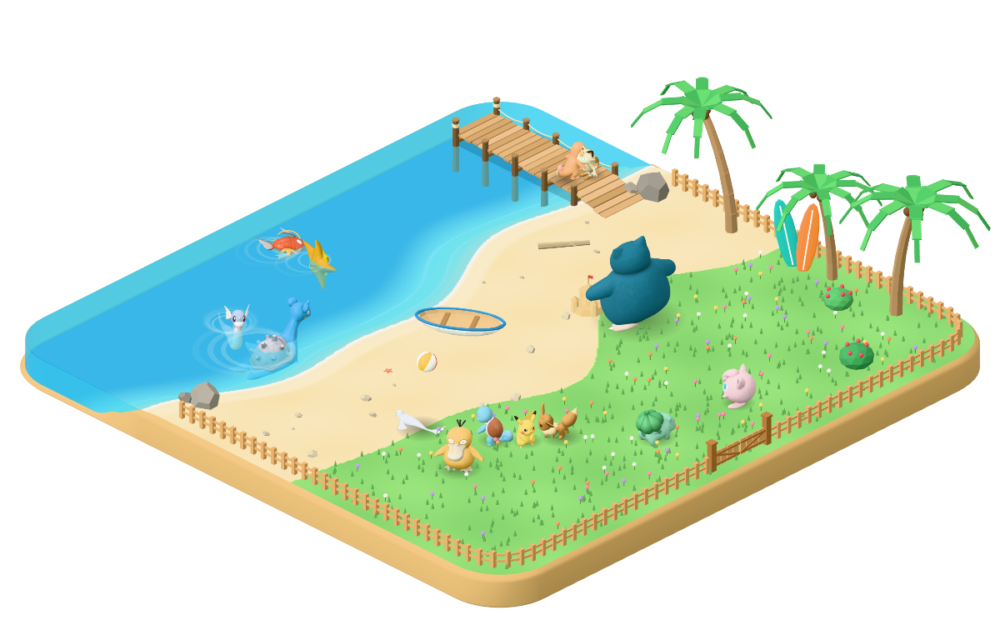

> **Unofficial fan project.** Not affiliated with or endorsed by Nintendo, Creatures, GAME FREAK or The Pokémon Company.
>
> This repo **contains no Pokémon models**. The picture above and the snowfield picture under "Features" show the app running with models installed and are for illustration only; the map screenshots show scenery only. You need to obtain the models yourself from the original project and put them in `agent-pets/models/`; the app reads that folder on startup.

> **Note:** the app's interface (menus, bubbles) and the linked documents under `docs/` are in Traditional Chinese. Menu names below are given with the original Chinese in parentheses.

## Features

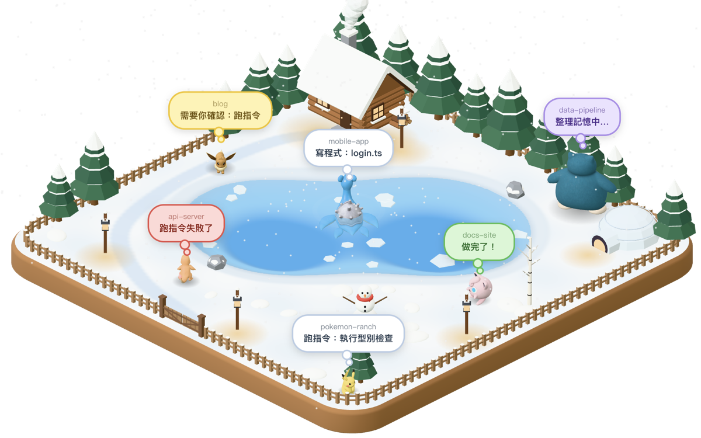

| What the agent is doing | How the pet reacts |
|------|------|
| A new session shows activity for the first time | Adopts a random species not yet on the ranch; it stays after the app restarts |
| Working (reading files, writing code, running commands, searching…) | White cloud bubble, e.g. "Running: type check" |
| Waiting for you (permission, a question, a plan) | Yellow bubble + bouncing, stops and faces you, a chime |
| A tool failed | Red bubble, attack animation, a low tone |
| Compacting the conversation | Lavender bubble |
| Turn finished | Green "Done!", happy animation, three rising notes |
| No activity for 5 minutes | Lies down to sleep with floating Zzz; wakes on the next event |
| Session ended | The pet stays on the ranch; remove it with "Release" from the menu (the Dock on macOS, the system tray on Windows) |

When nothing is going on, the pets live their own lives:

- **Everyone has a habitat**: land types walk on the grass, water types swim, amphibians go both ways.
- **They fight**: two pets bumping head-on may start a fight; the loser runs off sweating to the other side.
- **All 151 are there**: sized by class, so Snorlax next to Rattata looks right.
- **Two modes**: a small always-on-top ranch (drag it around, pet the Pokémon) or a wallpaper mode below your desktop icons (macOS only; Windows has the always-on-top ranch only).

All scenery is generated in code and all sounds are synthesized live with Web Audio — apart from the models there are no asset files.

## Maps

Eight maps, switchable from the menu, or pick a random one on every launch. Both platforms share the same maps and models.

| Left Sea | Crater Lake |
|:---:|:---:|
| 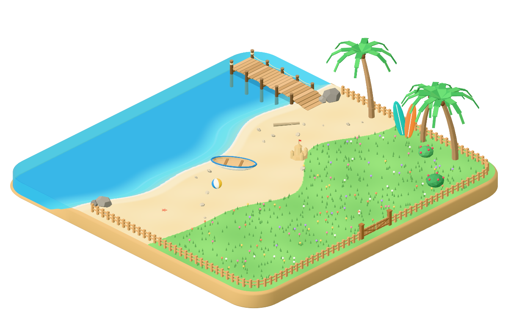 | 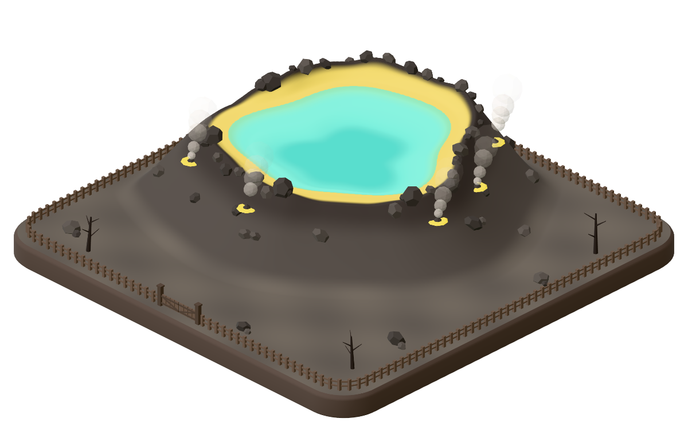 |
| A sandy beach with palm trees and a wooden pier reaching into the sea; pets walk onto it | An active volcano with a lake at its summit; water types swim in the lake, the others stay on the plain below |

| Central River | Snowfield |
|:---:|:---:|
| 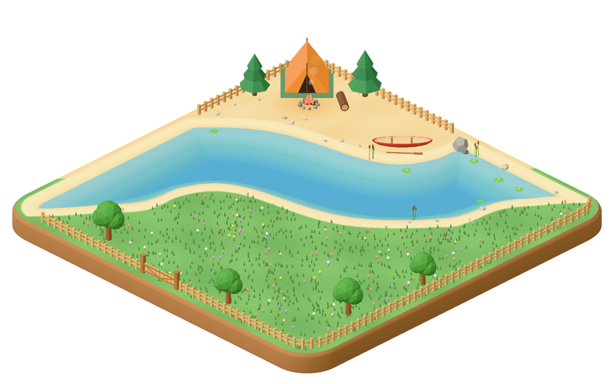 | 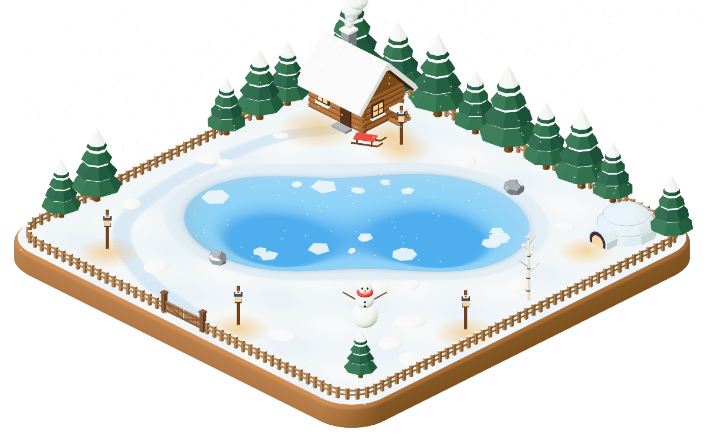 |
| A gently curving river splits the ranch in two; a campsite with a campfire on the upper bank | A lit log cabin, pine woods, an igloo and a snowman, with snow falling |

| Cherry Blossom Garden | Central Islet |
|:---:|:---:|
| 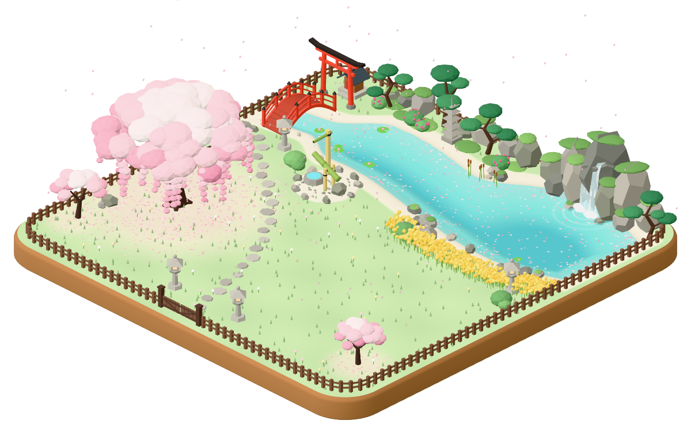 | 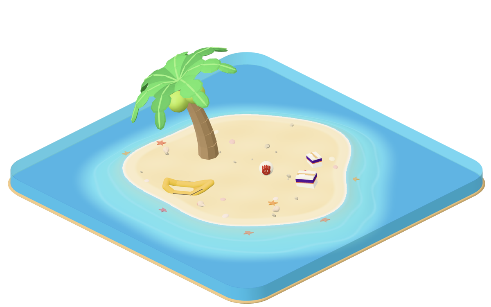 |
| A Japanese pond garden: waterfall rocks, an arched bridge and torii, a weeping cherry, a working shishi-odoshi, falling petals | A sandy island surrounded by sea with a big palm tree, a volleyball, two washed-up parcels and a half-buried yellow rubber dinghy; water types swim around the island |

| Moon Base | Undersea World |
|:---:|:---:|
| 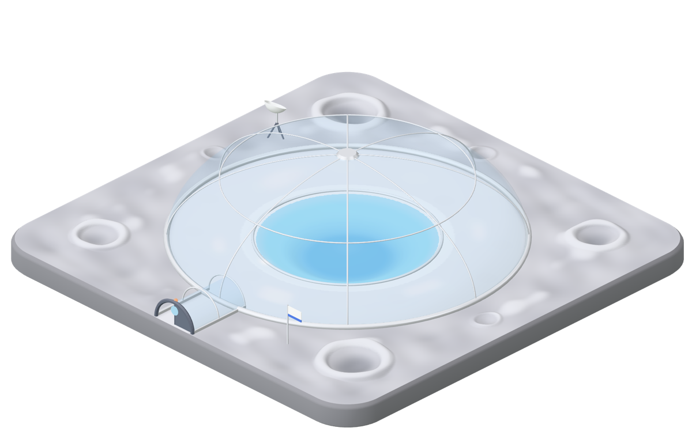 | 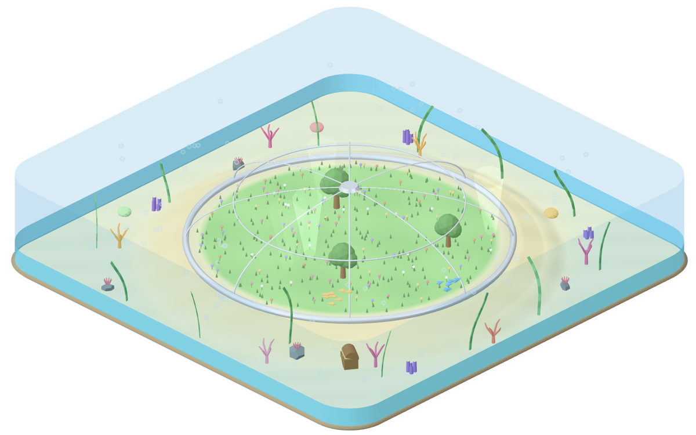 |
| A pale blue glass dome on the lunar surface with a round pool in the middle and a glass corridor leading to a door at the island's edge; pets stay inside the dome and corridor. Outside, the bumpy cratered surface is roamed by 10 Clefairy, 2 Clefable and 1 Jigglypuff (NPCs that belong to no session) | The whole island sits underwater like an aquarium: a glass dome in the middle holds land with trees and flowers; outside is the sea, where water and amphibious Pokémon float at different heights above the seabed, their shadows showing how high they are. Corals, swaying kelp, a treasure chest, rising bubbles and schools of small fish circling the dome |

## Requirements

- macOS (developed and tested on Apple Silicon) or Windows 10 / 11
- Node.js 22.12 or later
- [Claude Code](https://claude.com/claude-code) or Codex
- Pokémon models (obtain them yourself, see below)

## Quick start

The full steps (each with a way to verify it) are in **[docs/install.md](docs/install.md)** (Chinese). That document is precise enough to hand to your AI agent and let it follow along. Here's the outline:

**1. Install dependencies**

```bash
cd agent-pets
```

```bash
npm install
```

**2. Prepare the models**

The models come from [06wj/pokemon](https://github.com/06wj/pokemon); anything placed in `agent-pets/models/` is picked up. For which version, which files and how to verify them, see [docs/install.md](docs/install.md#2-準備模型). You don't need all 151 — a few are enough to run.

The original project's code is MIT, but the models are not: the characters and assets belong to their respective rights holders. Decide for yourself whether to obtain them, use them only on your own computer, and don't commit or share them.

**3. Install the hooks**

The hook files are in [`hooks/`](hooks/); see [hooks/README.md](hooks/README.md) (Chinese).

- Claude Code: merge the example settings into `~/.claude/settings.json` (`%USERPROFILE%\.claude\settings.json` on Windows). Use [`claude-settings.example.json`](hooks/claude-settings.example.json) on macOS and [`claude-settings.example.windows.json`](hooks/claude-settings.example.windows.json) on Windows.
- Codex: see the [Codex integration guide](docs/codex-hooks.md) (Chinese).

**4. Start it**

Development mode:

```bash
npm run dev
```

Or package it as an app (unsigned, for your own machine; `dist:mac` on macOS, `dist:win` on Windows):

```bash
npm run dist:mac
```

```bash
npm run dist:win
```

```bash
npm run app:open
```

Open a new agent session and send a message — a Pokémon will come and adopt it.

## Usage

Everything lives in one menu: **the right-click menu of the Dock icon on macOS, or the Poké Ball icon in the system tray (bottom right) on Windows** (left or right click; the Windows menu ends with "Quit Pokemon Ranch" (結束寶可夢牧場)):

| Menu | What it does |
|------|------|
| Pets on the ranch (牧場上的寵物) | Lists each pet and its session; the submenu can "Release" (放生) it |
| Release all (全部放生) | Clears the ranch after confirmation; sessions still online re-adopt on their next activity |
| Always-on-top ranch / Wallpaper mode (置頂小牧場／桌布模式) | Switch between the two modes (macOS only) |
| Wallpaper display (桌布放在哪個螢幕) | Which screen the wallpaper mode covers (macOS only) |
| Always on top (置頂) | Whether the small ranch stays above other windows; untick it to make it a normal window |
| Map (地圖) | Random (one per launch) or a fixed map |
| Rescan models, Open models folder (重新掃描模型、打開模型資料夾) | Use after adding or replacing models |

- **Always-on-top ranch** (default): transparent and always on top (can be turned off with "Always on top"). The mouse is captured only over the grass; everywhere else clicks go through to the windows behind. Click a pet to pet it; drag the grass to move the whole ranch.
- **Wallpaper mode** (macOS only): covers one screen below all windows and desktop icons, and ignores the mouse. Windows has no wallpaper mode.

Saves are stored in `~/Library/Application Support/Pokemon Ranch Pets/` on macOS and `%APPDATA%\Pokemon Ranch Pets\` on Windows.

## Showcase site

You can look around without installing hooks, alongside the app:

```bash
npm run showcase
```

It opens at <http://127.0.0.1:5188/>: a live ranch you can send fake events to, plus a motion index of all 151. The dev server reads the models straight from your local `agent-pets/models/` — nothing is copied or built.

## How it works

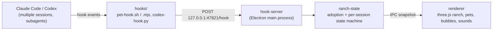

- **Privacy**: only the fields it needs are taken from each event (session ID, event name, tool name, working directory). Bubble text keeps only things that reveal nothing private, such as file names, short command descriptions and domains. Prompts, the commands themselves, file contents and agent replies are discarded right after reading — never stored or logged.
- **Security**: listens on `127.0.0.1` only and rejects every request with an `Origin` header, so web pages in a browser can't pretend to be an agent.
- **Doesn't slow your agent down**: the hook always exits successfully and waits at most 1 second; when the pet isn't running the connection is refused immediately. The Claude Code hook prints nothing; the Codex hook prints only an empty `{}` (Codex expects JSON), which doesn't affect permissions or add prompts.
- **Subagents don't get their own pets**: subagent events only count as "this session is still active", and a subagent asking for permission turns the pet yellow just the same.

## Project layout

```
pokemon-agent-pets/
├── agent-pets/          the desktop pet (run npm commands here)
│   ├── electron/        main process: windows, menu, hook server, adoption and state machine; platform/ holds per-OS settings
│   ├── src/             renderer: ranch scene, maps, pets, bubbles, sounds
│   ├── shared/          message formats and size classes shared by main and renderer
│   ├── showcase/        local showcase site
│   ├── scripts/         model download and checks, data tables, opening/closing the app
│   └── models/          models (not in git, bring your own)
├── hooks/               hooks to install into Claude Code / Codex
└── docs/                install steps, architecture, data table of all 151
```

| Document (Chinese) | Contents |
|------|------|
| [docs/install.md](docs/install.md) | Full install and launch steps, FAQ |
| [docs/features.md](docs/features.md) | Feature guide written for AI agents to answer users: bubble colors, name tags, menu, privacy, common questions |
| [hooks/README.md](hooks/README.md) | Installing the hooks |
| [docs/codex-hooks.md](docs/codex-hooks.md) | Codex integration |
| [docs/architecture.md](docs/architecture.md) | Code structure, data flow, state machine, how to add a map |
| [agent-pets/README.md](agent-pets/README.md) | Details of every feature and every file |
| [docs/species.md](docs/species.md) | Size classes, height/weight and types of all 151 (also as [HTML](docs/species.html) and [CSV](docs/species.csv)) |

Tech: TypeScript, Electron 45, Vite, three.js 0.187.

## Development

```bash
npm run dev          # development mode (Electron + Vite)
npm run build        # type check + build
npm test             # tests for the hook adapters and the ranch state machine
npm run showcase     # showcase site
```

When testing, use a different port and save folder so you don't touch the ranch you're using. macOS:

```bash
PET_DATA_DIR="$(mktemp -d /tmp/pokemon-ranch-test.XXXXXX)" PET_HOOK_PORT=47899 npm run dev
```

Windows (PowerShell):

```powershell
$env:PET_DATA_DIR="$env:TEMP\ranch-test"; $env:PET_HOOK_PORT=47899; npm run dev
```

## Assets and data sources

- **Models**: [06wj/pokemon](https://github.com/06wj/pokemon). This repo neither contains nor distributes models; the rights belong to their owners.
- **Type data**: `pokemonTypes.ts` from 06wj/pokemon (MIT).
- **Official heights and weights**: CSV data from [PokeAPI](https://pokeapi.co/).
- **Hook script rules** (no output, always exit successfully, time-limited): inspired by claude-office and pixel-agents.

## License

Code, scripts and documentation are licensed under [MIT](LICENSE). The license covers only the code and documents in this repo and **does not cover** Pokémon names, characters, models or other assets, which belong to their respective rights holders (see the disclaimer below).

## Disclaimer

- This is an unofficial fan project, not affiliated with or endorsed by Nintendo, Creatures, GAME FREAK or The Pokémon Company. Pokémon and related names are trademarks of their respective owners.
- Models are not included in this repo; please don't attach model files to issues or PRs. The characters in the two illustrative screenshots with Pokémon in this README (the top one and the snowfield one) belong to their respective rights holders.
