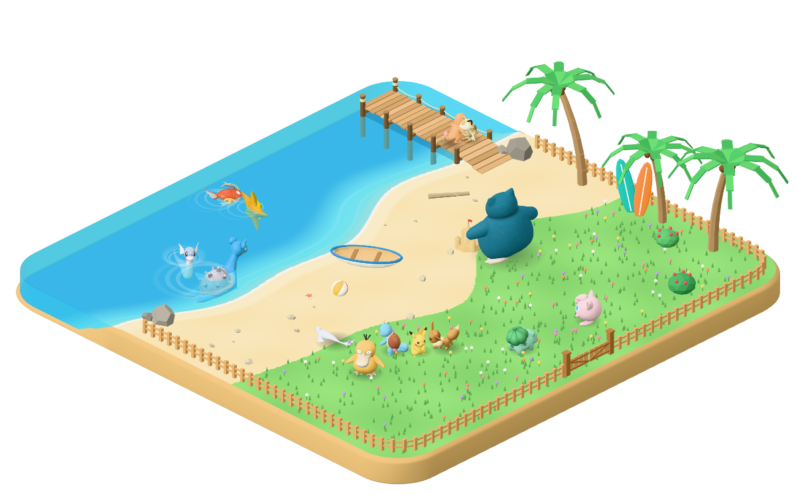
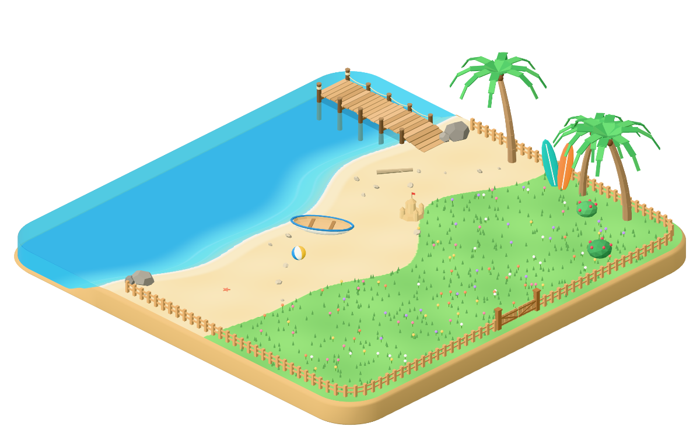
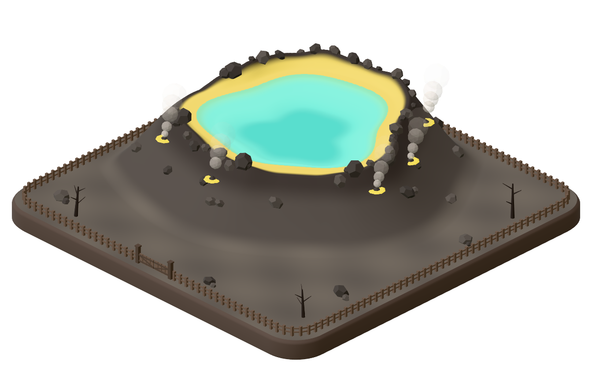
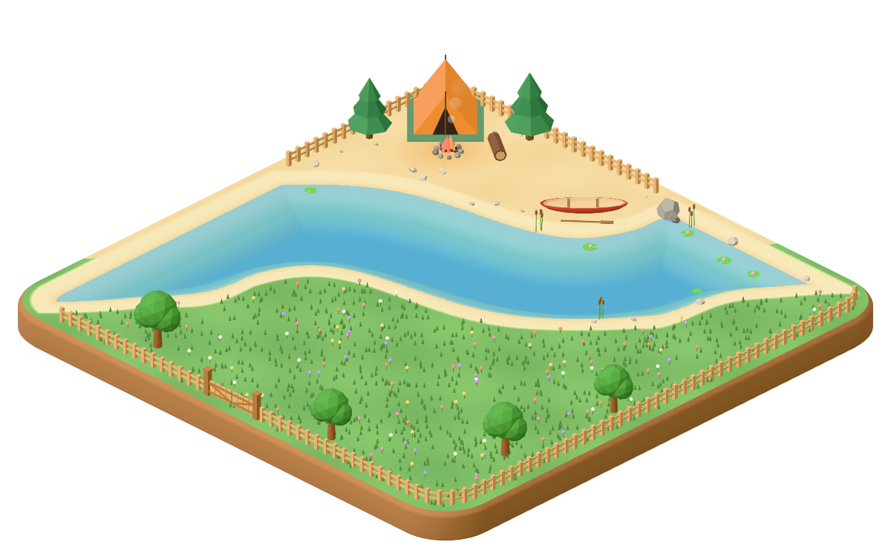
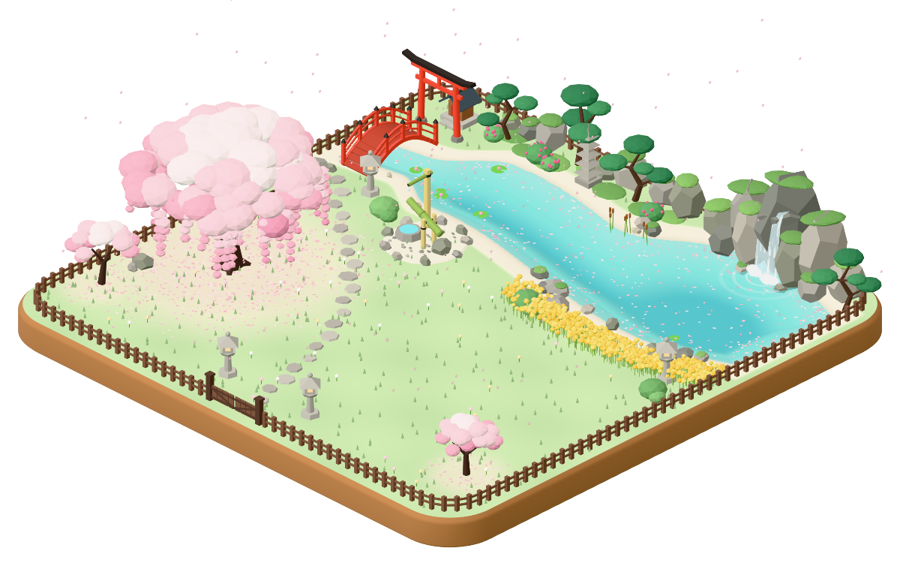
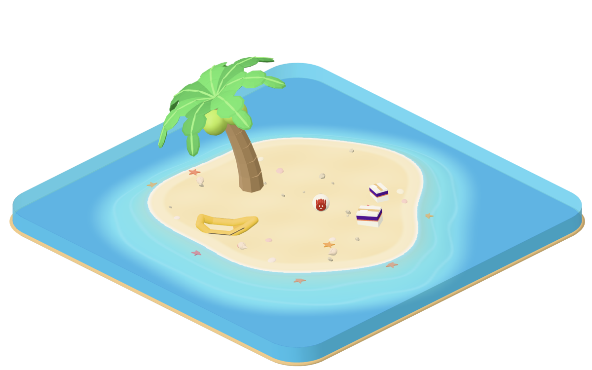
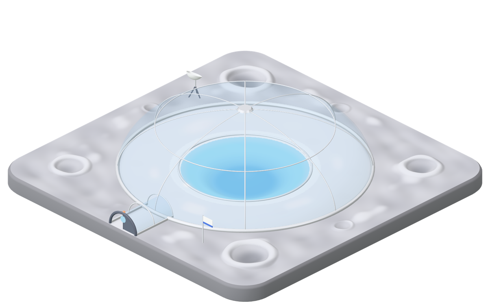
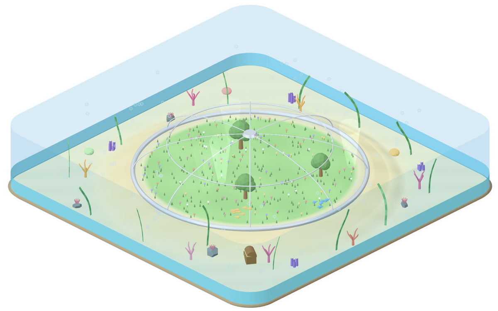
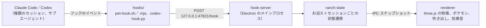

# ポケモン牧場（Pokemon Ranch Pets）

[繁體中文](README.md) | [English](README.en.md) | **日本語**

AI コーディングエージェントの作業状況を「見える化」するデスクトップペットです。macOS と Windows で動きます。

デスクトップに 3D のアイソメトリックな小島があり、**Claude Code／Codex のセッションごとに第一世代のポケモンを 1 匹ずつ迎えます**。ポケモンは牧場を自由に歩き回り、頭の上の雲の吹き出しにエージェントの作業内容が表示されます。確認待ち・エラー・完了のときは色と音でお知らせするので、複数のセッションを開いていても一つずつ切り替えて確認する必要はありません。



> **非公式のファンプロジェクトです。** 任天堂、クリーチャーズ、ゲームフリーク、株式会社ポケモンとは一切関係がなく、承認も受けていません。
>
> このリポジトリには**ポケモンのモデルは一切含まれていません**。上の画像と「機能」にある雪原の画像は、モデルを入れて実際に動かした様子のイメージです。「マップ」のスクリーンショットは風景だけです。モデルは元のプロジェクトからご自身で入手し、`agent-pets/models/` に置いてください。起動時にそのフォルダが自動で読み込まれます。

> **ご注意：** アプリの画面（メニューや吹き出し）と `docs/` 以下のリンク先ドキュメントは繁体字中国語です。以下のメニュー名には、括弧内に元の中国語を併記しています。

## 機能


| エージェントの状態 | ポケモンの反応 |
|------|------|
| 新しいセッションで初めて動きがあった | 牧場にまだいない種類からランダムに 1 匹を迎える。アプリを再起動しても残る |
| 作業中（ファイルを読む、コードを書く、コマンドを実行する、調べ物をする…） | 白い雲の吹き出し。例：「コマンド実行：型チェック」 |
| 確認待ち（権限、質問、プランの承認） | 黄色の吹き出し＋ジャンプ。立ち止まってこちらを向き、チャイムが鳴る |
| ツールが失敗した | 赤い吹き出し、攻撃モーション、低い警告音 |
| 会話の整理中（圧縮） | 薄紫の吹き出し |
| このターンが完了した | 緑の「できた！」、喜ぶモーション、上がっていく 3 音 |
| 5 分間動きがない | 横になって眠り、Zzz が浮かぶ。次のイベントで目を覚ます |
| セッションが終了した | ポケモンは牧場に残る。外すときはメニュー（macOS は Dock、Windows はシステムトレイ）から「逃がす」 |

何もないときも、ポケモンたちは自分の暮らしを送っています。

- **それぞれの居場所**：陸のポケモンは草地を歩き、みずタイプは水の中を泳ぎ、両生のポケモンはどちらにも行けます。
- **ケンカをする**：2 匹が正面からぶつかると、ときどきケンカが始まり、負けたほうは汗をかきながら反対側へ逃げていきます。
- **151 匹すべて揃っている**：体格ごとにサイズ分けしているので、カビゴンとコラッタが並ぶと大きさの違いがちゃんとわかります。
- **2 つのモード**：常に最前面に表示される小さな牧場（ドラッグで移動したり、ポケモンをなでたりできます）と、デスクトップアイコンの下に敷く壁紙モード（macOS のみ。Windows は最前面の小さな牧場だけです）。

風景はすべてプログラムで生成し、効果音は Web Audio でその場で合成しています。モデル以外の素材ファイルはありません。

## マップ

マップは 8 種類。メニューから切り替えられ、起動するたびにランダムで選ぶこともできます。マップとモデルは両方のプラットフォームで共通です。

| 左の海 | 火口湖 |
|:---:|:---:|
|  |  |
| 砂浜とヤシの木、海へ伸びる木の桟橋。ポケモンは桟橋の上にも行けます | 頂上に湖のある活火山。みずタイプは湖の中、ほかのポケモンはふもとの平地にいます |

| 中央の川 | 雪原 |
|:---:|:---:|
|  |  |
| ゆるやかに曲がる川が牧場を二つに分け、上の岸にはキャンプ場とたき火があります | 明かりの灯る丸太小屋、松林、かまくら、雪だるま。空から雪が降っています |

| 和風お花見 | 中央の島 |
|:---:|:---:|
|  |  |
| 池泉庭園：滝石組、太鼓橋と鳥居、しだれ桜、動く鹿威し。花びらが舞い散ります | 四方を海に囲まれた砂の島。大きなヤシの木、バレーボール、流れ着いた荷物が 2 つ、砂に半分埋まった黄色いゴムボート。みずタイプは島のまわりを泳ぎます |

| 月面基地 | 海底世界 |
|:---:|:---:|
|  |  |
| 月面にある淡い青の大きなガラスドーム。中央に丸いプールがあり、左下のガラス通路は島の端の扉まで続いています。ポケモンはドームと通路の中だけにいます。ドームの外は起伏とクレーターのある月面で、ピッピ 10 匹、ピクシー 2 匹、プリン 1 匹が歩き回っています（どのセッションにも属さない NPC） | 島全体が海の底に沈んだ、水槽のようなマップ。中央のガラスドームの中には木や花のある陸地があり、外側は海です。みずタイプと両生のポケモンは海底からいろいろな高さに浮かび、ゆっくり上下します。海底の影で浮いている高さがわかります。サンゴ、揺れる海藻、宝箱、立ちのぼる泡、ドームのまわりを泳ぐ小魚の群れ |

## 必要なもの

- macOS（Apple Silicon で開発・テスト）または Windows 10／11
- Node.js 22.12 以上
- [Claude Code](https://claude.com/claude-code) または Codex
- ポケモンのモデル（ご自身で入手してください。次の節を参照）

## クイックスタート

すべての手順（各ステップに確認方法つき）は **[docs/install.md](docs/install.md)**（中国語）にあります。AI エージェントにそのまま渡して手順どおりに進めてもらえるくらい具体的に書いてあります。ここでは概要だけ紹介します。

**1. パッケージのインストール**

```bash
cd agent-pets
```

```bash
npm install
```

**2. モデルの準備**

モデルは [06wj/pokemon](https://github.com/06wj/pokemon) のもので、`agent-pets/models/` に置けば読み込まれます。どのバージョンのどのファイルを使うか、どう確認するかは [docs/install.md](docs/install.md#2-準備模型) を見てください。151 匹すべてそろえる必要はなく、数匹だけでも動きます。

元のプロジェクトのコードは MIT ですが、モデルは違います。キャラクターと素材はそれぞれの権利者のものです。入手するかどうかはご自身で判断し、自分のパソコンの中だけで使い、git に入れたり共有したりしないでください。

**3. フックのインストール**

フックのファイルは [`hooks/`](hooks/) にあります。説明は [hooks/README.md](hooks/README.md)（中国語）を見てください。

- Claude Code：設定例を `~/.claude/settings.json`（Windows は `%USERPROFILE%\.claude\settings.json`）にマージします。macOS は [`claude-settings.example.json`](hooks/claude-settings.example.json)、Windows は [`claude-settings.example.windows.json`](hooks/claude-settings.example.windows.json) を使います。
- Codex：[Codex 連携ガイド](docs/codex-hooks.md)（中国語）を見てください。

**4. 起動**

開発モード：

```bash
npm run dev
```

または、アプリとしてパッケージ化します（署名なし、自分のパソコン用。macOS は `dist:mac`、Windows は `dist:win`）。

```bash
npm run dist:mac
```

```bash
npm run dist:win
```

```bash
npm run app:open
```

新しいエージェントのセッションを開いてメッセージを送ると、ポケモンが 1 匹やってきます。

## 使い方

設定はすべて 1 つのメニューにまとまっています。**macOS は Dock アイコンの右クリックメニュー、Windows はシステムトレイ（右下）のモンスターボールのアイコン**です（左クリックでも右クリックでも開きます。Windows のメニューの最後には「ポケモン牧場を終了」（結束寶可夢牧場）があります）。

| メニュー | 内容 |
|------|------|
| 牧場のポケモン（牧場上的寵物） | 1 匹ずつとそのセッションの一覧。サブメニューから「逃がす」（放生）ができます |
| すべて逃がす（全部放生） | 確認のあと牧場を空にします。まだオンラインのセッションは、次に動きがあったときにまた迎えます |
| 最前面の牧場／壁紙モード（置頂小牧場／桌布模式） | 2 つのモードを切り替え（macOS のみ） |
| 壁紙を表示する画面（桌布放在哪個螢幕） | 壁紙モードで使う画面（macOS のみ） |
| 最前面に表示（置頂） | 小さな牧場を常に最前面に置くかどうか。チェックを外すと通常のウィンドウになり、ほかのウィンドウの下に隠れます |
| マップ（地圖） | ランダム（起動ごとに 1 つ選ぶ）または固定 |
| モデルを再スキャン、モデルフォルダを開く（重新掃描模型、打開模型資料夾） | モデルを追加・入れ替えたあとに使います |

- **最前面の牧場**（初期設定）：透明で最前面に表示されます（メニューの「最前面に表示」でオフにできます）。カーソルが草地の上にあるときだけマウスを受け取り、それ以外の場所では後ろのウィンドウをクリックできます。ポケモンをクリックするとなでられ、草地をドラッグすると牧場ごと移動できます。
- **壁紙モード**（macOS のみ）：1 つの画面いっぱいに、すべてのウィンドウとデスクトップアイコンの下に表示されます。マウスは受け取りません。Windows には壁紙モードはありません。

セーブデータは macOS では `~/Library/Application Support/Pokemon Ranch Pets/`、Windows では `%APPDATA%\Pokemon Ranch Pets\` にあります。

## ショーケースサイト

フックを入れなくても見られて、アプリと同時に開けます。

```bash
npm run showcase
```

<http://127.0.0.1:5188/> で開きます。偽のイベントを送れる動く牧場と、151 匹のモーション図鑑があります。モデルは開発サーバーがローカルの `agent-pets/models/` から直接読み込むので、コピーやビルドはしません。

## しくみ



- **プライバシー**：イベントから使うフィールドだけを取り出します（セッション ID、イベント名、ツール名、作業ディレクトリ）。吹き出しには、ファイル名、コマンドの短い説明、ドメインなど、プライバシーにかかわらないものだけを表示します。プロンプト、コマンドそのもの、ファイルの内容、エージェントの返答は読んだらすぐに捨て、保存もログ出力もしません。
- **セキュリティ**：`127.0.0.1` だけで待ち受け、`Origin` ヘッダー付きのリクエストはすべて拒否します。ブラウザ上のウェブページがエージェントになりすますことはできません。
- **エージェントを遅くしない**：フックは必ず正常終了し、待つのは最大 1 秒です。ペットが起動していないときは接続がすぐに拒否されます。Claude Code のフックは何も出力しません。Codex のフックは空の `{}` だけを返します（Codex が JSON を求めるため）。権限には影響せず、プロンプトにも何も追加しません。
- **サブエージェントには専用のポケモンはいません**：サブエージェントのイベントは「このセッションはまだ動いている」として扱い、サブエージェントが権限を求めたときも同じように黄色になります。

## プロジェクト構成

```
pokemon-agent-pets/
├── agent-pets/          デスクトップペット本体（npm コマンドはここで実行）
│   ├── electron/        メインプロセス：ウィンドウ、メニュー、フックサーバー、お迎えと状態遷移。platform/ は OS ごとの設定
│   ├── src/             renderer：牧場のシーン、マップ、ポケモン、吹き出し、効果音
│   ├── shared/          メインプロセスと renderer で共有するメッセージ形式、サイズ区分
│   ├── showcase/        ローカルのショーケースサイト
│   ├── scripts/         モデルのダウンロードと検証、データ表の生成、アプリの起動・終了
│   └── models/          モデル（git には入れません。各自で用意）
├── hooks/               Claude Code／Codex に入れるフック
└── docs/                インストール手順、構成の説明、151 匹のデータ表
```

| ドキュメント（中国語） | 内容 |
|------|------|
| [docs/install.md](docs/install.md) | インストールと起動の全手順、よくある質問 |
| [docs/features.md](docs/features.md) | AI エージェントがユーザーの質問に答えるための機能説明：吹き出しの色、名札、メニュー、プライバシー、よくある質問 |
| [hooks/README.md](hooks/README.md) | フックのインストールと説明 |
| [docs/codex-hooks.md](docs/codex-hooks.md) | Codex 連携 |
| [docs/architecture.md](docs/architecture.md) | コードの構成、データの流れ、状態遷移、マップの追加方法 |
| [agent-pets/README.md](agent-pets/README.md) | すべての機能とファイルの詳細 |
| [docs/species.md](docs/species.md) | 151 匹のサイズ区分、身長・体重、タイプ（[HTML](docs/species.html) と [CSV](docs/species.csv) もあります） |

技術：TypeScript、Electron 45、Vite、three.js 0.187。

## 開発

```bash
npm run dev          # 開発モード（Electron＋Vite）
npm run build        # 型チェック＋ビルド
npm test             # フックのアダプターと牧場の状態遷移のテスト
npm run showcase     # ショーケースサイト
```

テストのときは、使っている牧場に触れないよう、ポートとセーブフォルダを変えてください。macOS：

```bash
PET_DATA_DIR="$(mktemp -d /tmp/pokemon-ranch-test.XXXXXX)" PET_HOOK_PORT=47899 npm run dev
```

Windows（PowerShell）：

```powershell
$env:PET_DATA_DIR="$env:TEMP\ranch-test"; $env:PET_HOOK_PORT=47899; npm run dev
```

## 素材とデータの出典

- **モデル**：[06wj/pokemon](https://github.com/06wj/pokemon)。このリポジトリはモデルを含まず、配布もしません。権利は各権利者にあります。
- **タイプのデータ**：06wj/pokemon の `pokemonTypes.ts`（MIT）。
- **公式の身長・体重**：[PokeAPI](https://pokeapi.co/) の CSV データ。
- **フックスクリプトのルール**（何も出力しない、必ず正常終了する、時間制限あり）：claude-office と pixel-agents を参考にしました。

## ライセンス

コード、スクリプト、ドキュメントは [MIT](LICENSE) ライセンスです。ライセンスの対象はこのリポジトリのコードとドキュメントだけで、ポケモンの名前、キャラクター、モデル、その他の素材は**含みません**。それらはそれぞれの権利者のものです（下の免責事項を参照）。

## 免責事項

- これは非公式のファンプロジェクトで、任天堂、クリーチャーズ、ゲームフリーク、株式会社ポケモンとは一切関係がなく、承認も受けていません。ポケモン（Pokémon）および関連する名称は、それぞれの権利者の商標です。
- モデルはこのリポジトリに含まれていません。Issue や PR にモデルファイルを添付しないでください。この README にあるポケモンの写ったイメージ画像 2 枚（一番上と雪原）のキャラクターは、それぞれの権利者のものです。
