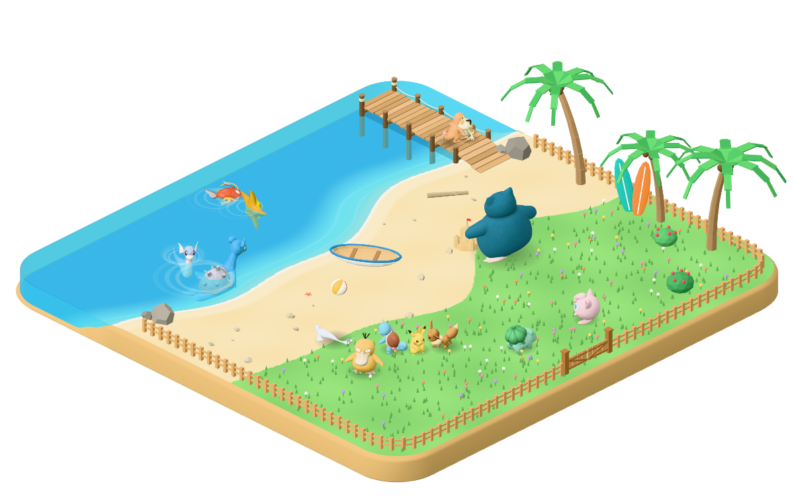
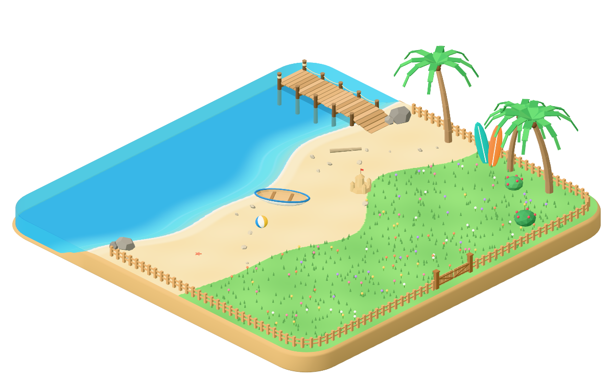
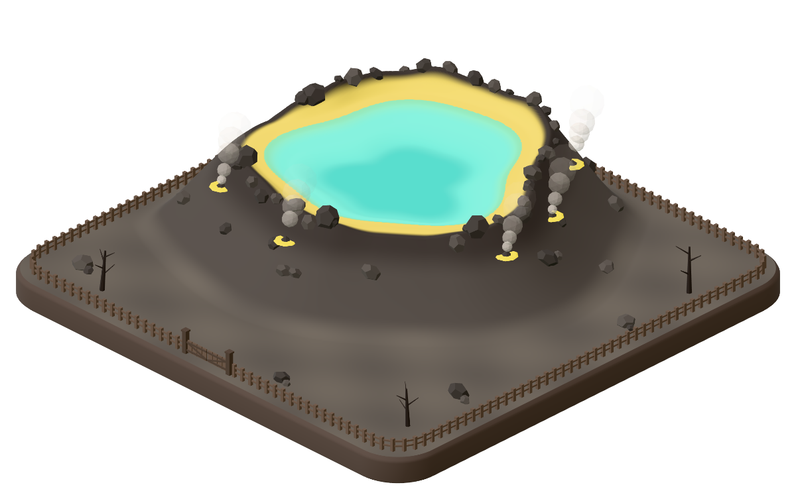
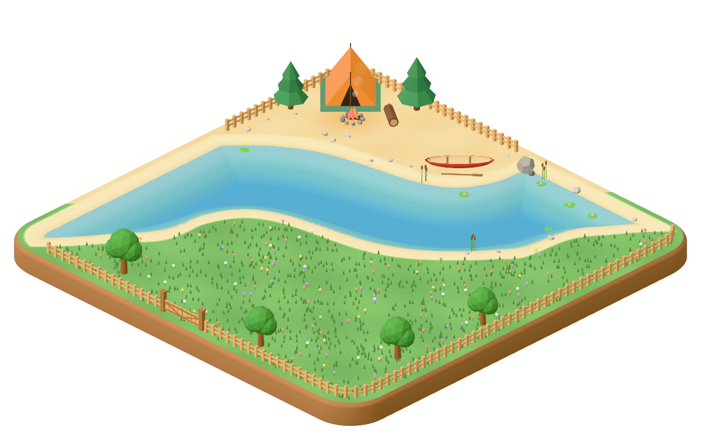
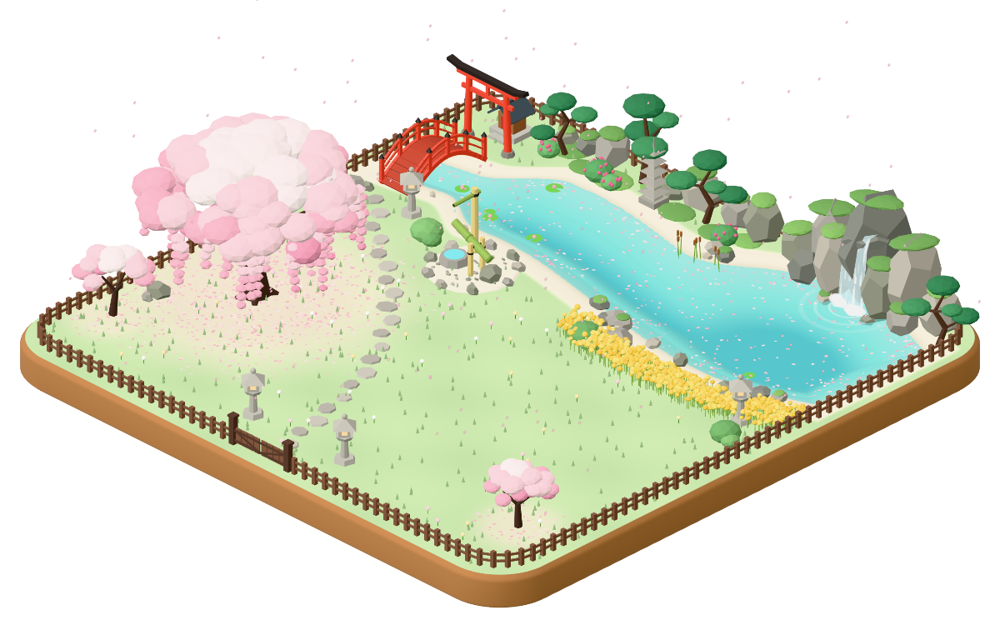
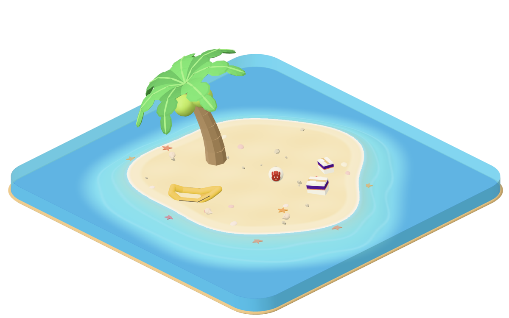
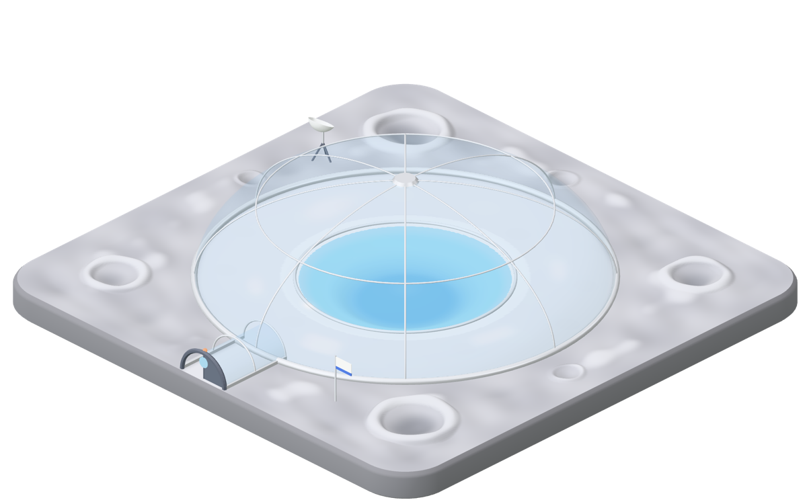
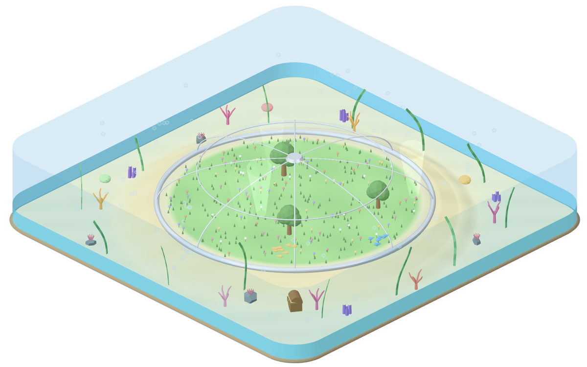
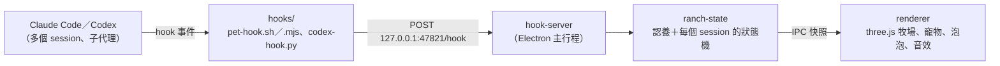

# 寶可夢牧場（Pokemon Ranch Pets）

**繁體中文** | [English](README.en.md) | [日本語](README.ja.md)

讓 AI coding agent 的工作狀態「看得見」的桌寵，macOS 與 Windows 都能用。

桌面上有一座 3D 等角小島，**每個 Claude Code／Codex session 認養一隻第一代寶可夢**。寵物在牧場裡自由走動，頭上的雲朵泡泡顯示 agent 正在做什麼；等你確認、出錯、做完的時候，用顏色和音效提醒你。同時開好幾個 session 也不用一個個切回去看。



> **非官方的粉絲專案。** 與任天堂、Creatures、GAME FREAK、The Pokémon Company 無關，也未獲背書。
>
> 這個 repo **不包含任何寶可夢模型**。上面這張和「功能」裡的雪地那張，是放了模型之後實際跑起來的樣子，只當示意；「地圖」的截圖只有場景。模型要自己從原專案取得，放進 `agent-pets/models/`，程式啟動時會自動讀那個資料夾。

## 功能


| agent 的情況 | 寵物的反應 |
|------|------|
| 新 session 第一次有動靜 | 從牧場上還沒有的品種裡隨機認養一隻，重開 App 還在 |
| 在做事（讀檔、寫程式、跑指令、查資料…） | 白色雲朵泡泡，例如「跑指令：執行型別檢查」 |
| 等你確認（權限、問問題、計畫） | 黃色泡泡＋跳動，停下來面向你，叮咚聲 |
| 工具失敗 | 紅色泡泡，播攻擊動作，低音提示聲 |
| 整理記憶（壓縮對話） | 淡紫泡泡 |
| 這一輪做完 | 綠色「做完了！」，播開心動作，上揚三音 |
| 5 分鐘沒有動靜 | 躺下睡覺、飄 Zzz，下一個事件就醒來 |
| session 結束 | 寵物留在牧場上，要拿掉從選單（macOS 的 Dock、Windows 的系統匣）「放生」 |

沒事的時候寵物自己過日子：

- **各有各的地盤**：陸地的在草地上逛，水系的在水裡游，兩棲的兩邊都去。
- **會打架**：兩隻正面撞上有機率打一場，輸的冒著汗跑到另一頭。
- **151 隻都有**：依體型分級，卡比獸和小拉達站在一起看得出差別。
- **兩種模式**：置頂的小牧場（可以拖著搬、可以摸寵物），或鋪在桌面圖示底下的桌布模式（只有 macOS；Windows 只有置頂小牧場）。

場景全部用程式產生，音效用 Web Audio 現場合成，除了模型之外沒有其他素材檔。

## 地圖

八張地圖，從選單切換，也可以設成每次啟動隨機抽一張。兩個平台共用同一套地圖與模型。

| 左側海 | 火山口湖 |
|:---:|:---:|
|  |  |
| 沙灘、椰子樹，一座伸進海裡的木棧橋，寵物會走上去 | 活火山，湖在山頂；水系在湖裡，其他寵物在山下的平地 |

| 中央河 | 雪地 |
|:---:|:---:|
|  |  |
| 一條微彎的河把牧場分成兩岸，上岸是營地與營火 | 亮著燈的小木屋、松林、雪屋與雪人，天上飄雪 |

| 日式賞櫻 | 中央島 |
|:---:|:---:|
|  |  |
| 池泉庭園：瀑布石組、太鼓橋與鳥居、枝垂櫻、會動的鹿威し，花瓣飄落 | 四面環海的沙島，一棵大椰子樹、一顆排球、兩個沖上岸的包裹和一艘半埋在沙裡的黃色橡皮艇，水系繞著島游 |

| 月面基地 | 海底世界 |
|:---:|:---:|
|  |  |
| 月面上一個淡藍的大玻璃罩，罩子正中央有一座圓形水池，左下一段玻璃通道通到小島邊緣的門；寵物只待在罩子和通道裡。罩外的月面高低起伏、有隕石坑，10 隻皮皮、2 隻皮可西和 1 隻胖丁在罩外自己逛（NPC，不屬於任何 session） | 整座島沉在海裡，像一缸水族箱：中間一個玻璃罩，裡面是長著樹和花的陸地；罩外是海，水系和兩棲的寶可夢浮在海床上不同的高度、慢慢上下飄，海床上的影子看得出浮多高。珊瑚、會晃的海草、寶箱、往上冒的氣泡、繞著罩子游的小魚群 |

## 需求

- macOS（在 Apple Silicon 上開發與測試）或 Windows 10／11
- Node.js 22.12 以上
- [Claude Code](https://claude.com/claude-code) 或 Codex
- 寶可夢模型（自己取得，見下一節）

## 快速開始

完整步驟（每一步都有確認方式）在 **[docs/install.md](docs/install.md)**。那份文件寫得夠明確，可以直接交給你的 AI agent 照著做。這裡是大綱：

**1. 安裝套件**

```bash
cd agent-pets
```

```bash
npm install
```

**2. 準備模型**

模型來自 [06wj/pokemon](https://github.com/06wj/pokemon)，放進 `agent-pets/models/` 就會被讀到。要拿哪個版本、哪些檔案、怎麼檢查，見 [docs/install.md](docs/install.md#2-準備模型)。不用 151 隻都拿，只放幾隻也能跑。

原專案的程式碼是 MIT，但模型不是：角色與素材屬於各自的權利方。請自己決定要不要取得，只在自己的電腦上用，不要放進 git、不要分享。

**3. 安裝 hooks**

hook 檔在 [`hooks/`](hooks/)，說明見 [hooks/README.md](hooks/README.md)。

- Claude Code：把設定範例合併進 `~/.claude/settings.json`（Windows 是 `%USERPROFILE%\.claude\settings.json`）。macOS 用 [`claude-settings.example.json`](hooks/claude-settings.example.json)，Windows 用 [`claude-settings.example.windows.json`](hooks/claude-settings.example.windows.json)。
- Codex：見 [Codex 接入說明](docs/codex-hooks.md)。

**4. 啟動**

開發模式：

```bash
npm run dev
```

或打包成 App（不簽章，給自己這台用；macOS 用 `dist:mac`、Windows 用 `dist:win`）：

```bash
npm run dist:mac
```

```bash
npm run dist:win
```

```bash
npm run app:open
```

新開一個 agent session、送出一句話，就會有一隻寶可夢來認養。

## 使用

所有設定都在一個選單裡：**macOS 是 Dock 圖示的右鍵選單，Windows 是系統匣（右下角）的精靈球圖示**（左鍵、右鍵都可以；Windows 的選單最後有「結束寶可夢牧場」）：

| 選單 | 用途 |
|------|------|
| 牧場上的寵物 | 列出每一隻和牠的 session，子選單可以「放生」 |
| 全部放生 | 確認後把牧場清空；還在線上的 session 之後有動靜會重新認養 |
| 置頂小牧場／桌布模式 | 切換兩種模式（只有 macOS） |
| 桌布放在哪個螢幕 | 桌布模式要鋪在哪個螢幕（只有 macOS） |
| 置頂 | 小牧場要不要一直在最上層；取消勾選就變成一般視窗，會被其他視窗蓋住 |
| 地圖 | 隨機（每次啟動抽一張），或固定用某一張 |
| 重新掃描模型、打開模型資料夾 | 新增或換模型之後用 |

- **置頂小牧場**（預設）：透明、置頂（選單「置頂」可以關掉）。游標在草地上才接滑鼠，其他地方點得到後面的視窗。點寵物是摸一下，按住草地拖曳可以搬動整座牧場。
- **桌布模式**（只有 macOS）：鋪滿一個螢幕，在所有視窗和桌面圖示底下，收不到滑鼠。Windows 不做桌布模式。

存檔在 macOS 的 `~/Library/Application Support/Pokemon Ranch Pets/`、Windows 的 `%APPDATA%\Pokemon Ranch Pets\`。

## 展示網站

不用裝 hooks 也能看，可以跟 App 同時開：

```bash
npm run showcase
```

開在 <http://127.0.0.1:5188/>：一座可以送假事件的活牧場，加上 151 隻的動作圖鑑。模型由開發伺服器直接讀本機的 `agent-pets/models/`，不複製、不 build。

## 運作方式



- **隱私**：只取事件裡用得到的欄位（session ID、事件名、工具名、工作目錄）。泡泡上的說明只留看不出隱私的東西，例如檔名、指令的簡短描述、網域。提示文字、指令本身、檔案內容、agent 的回覆讀完就丟，不保存、不寫 log。
- **安全**：只聽 `127.0.0.1`，帶 `Origin` 標頭的請求一律拒絕，避免瀏覽器裡的網頁冒充 agent。
- **不拖慢 agent**：hook 永遠成功結束、最多等 1 秒；桌寵沒開時連線立刻被拒。Claude Code 的 hook 不輸出任何東西；Codex 的只回一個空的 `{}`（Codex 要求回 JSON），不影響權限、不加提示。
- **子代理不另外養寵物**：子代理的事件只算「這個 session 還有動靜」，子代理要權限時一樣會變黃。

## 專案結構

```
pokemon-agent-pets/
├── agent-pets/          桌寵本體（npm 指令都在這裡跑）
│   ├── electron/        主行程：視窗、選單、hook 伺服器、認養與狀態機；platform/ 是各 OS 的設定檔
│   ├── src/             renderer：牧場場景、地圖、寵物、泡泡、音效
│   ├── shared/          主行程與 renderer 共用的訊息格式、尺寸級距
│   ├── showcase/        本機展示網站
│   ├── scripts/         模型下載與檢查、資料表產生、開關 App
│   └── models/          模型（不進 git，自己準備）
├── hooks/               要裝到 Claude Code／Codex 的 hook
└── docs/                安裝步驟、架構說明、151 隻的資料表
```

| 文件 | 內容 |
|------|------|
| [docs/install.md](docs/install.md) | 安裝與啟動的完整步驟、常見問題 |
| [docs/features.md](docs/features.md) | 功能說明（寫給 AI agent 讀，用來回答使用者）：泡泡顏色、名牌、選單、隱私、使用者常問的問題 |
| [hooks/README.md](hooks/README.md) | hook 的安裝與說明 |
| [docs/codex-hooks.md](docs/codex-hooks.md) | Codex 接入說明 |
| [docs/architecture.md](docs/architecture.md) | 程式分工、資料流、狀態機、怎麼新增地圖 |
| [agent-pets/README.md](agent-pets/README.md) | 每個功能的細節、每個檔案在做什麼 |
| [docs/species.md](docs/species.md) | 151 隻的尺寸級距、身高體重、屬性（另有 [HTML](docs/species.html) 與 [CSV](docs/species.csv)） |

技術：TypeScript、Electron 45、Vite、three.js 0.187。

## 開發

```bash
npm run dev          # 開發模式（Electron＋Vite）
npm run build        # 型別檢查＋建置
npm test             # hook 轉接器與牧場狀態機的測試
npm run showcase     # 展示網站
```

測試時請換 port 與存檔目錄，才不會動到正在用的牧場。macOS：

```bash
PET_DATA_DIR="$(mktemp -d /tmp/pokemon-ranch-test.XXXXXX)" PET_HOOK_PORT=47899 npm run dev
```

Windows（PowerShell）：

```powershell
$env:PET_DATA_DIR="$env:TEMP\ranch-test"; $env:PET_HOOK_PORT=47899; npm run dev
```

## 素材與資料來源

- **模型**：[06wj/pokemon](https://github.com/06wj/pokemon)。這個 repo 不包含、不散布模型，權利屬於原權利方。
- **屬性資料**：06wj/pokemon 的 `pokemonTypes.ts`（MIT）。
- **官方身高體重**：[PokeAPI](https://pokeapi.co/) 的 CSV 資料。
- **hook 腳本的規則**（不輸出、永遠成功結束、限時）：參考 claude-office 與 pixel-agents。

## 授權

程式碼、腳本與文件以 [MIT](LICENSE) 授權。授權只涵蓋這個 repo 裡的程式與文件，**不涵蓋**寶可夢的名稱、角色、模型與其他素材，那些屬於各自的權利方（見下面的聲明）。

## 聲明

- 這是非官方的粉絲專案，與任天堂、Creatures、GAME FREAK、The Pokémon Company 無關，也未獲背書。寶可夢（Pokémon）及相關名稱是各權利方的商標。
- 模型不放進這個 repo，請不要在 issue 或 PR 裡附上模型檔。README 裡兩張有寶可夢的示意圖（最上面那張和雪地那張），角色屬於各自的權利方。
